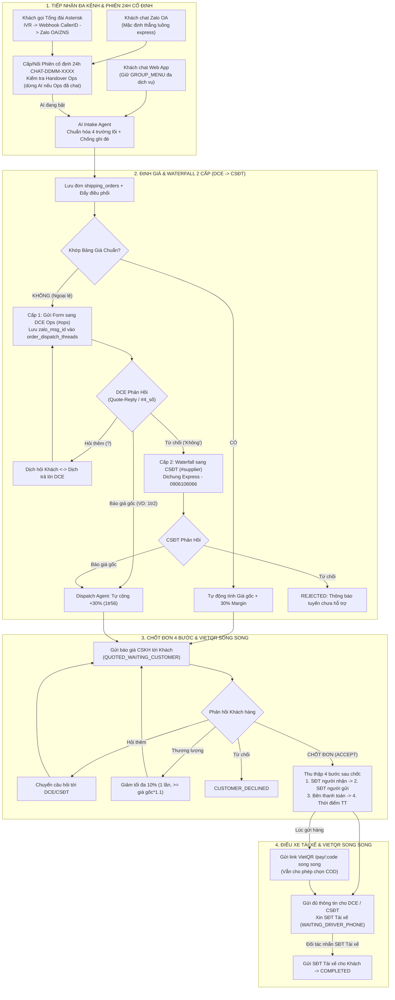

# ROADMAP & LUỒNG VẬN HÀNH TỰ ĐỘNG HÓA — DC EXPRESS SHIPBOT

Tài liệu này mô tả **Luồng vận hành toàn diện (End-to-End 15 Trạng thái)** và **Lộ trình triển khai** tự động hóa khép kín quy trình tiếp nhận, báo giá 2 cấp (`DCE -> CSĐT` `+30% Margin`), chốt đơn 4 bước, thanh toán VietQR song song và điều phối lấy hàng cho **Đi Chung Express (DC Express)**.

---

## 1. SƠ ĐỒ LUỒNG VẬN HÀNH TOÀN DIỆN (END-TO-END MULTI-AGENT WORKFLOW)



---

## 2. CHI TIẾT CÁC GIAI ĐOẠN ĐÃ HOÀN THÀNH

### GIAI ĐOẠN 0: Nền tảng Tiếp nhận & Phiên 24h Cố Định — ✅ ĐÃ HOÀN THÀNH
- [x] Thu thập & chuẩn hóa 4 thông tin đơn hàng + dịch ngược địa danh Việt Nam đến cấp Phường/Xã (`src/shared/data/vnAdministrative.ts`).
- [x] Chống AI ghi đè nhầm địa chỉ/thời gian bởi câu hỏi hoặc tin nhắn giục nhanh (`src/chatbot/extraction/express.ts`).
- [x] **Tách kênh Web vs Zalo OA**: Zalo OA mặc định đi thẳng vào `express` (bỏ `GROUP_MENU`), Web Chat giữ menu đa dịch vụ.
- [x] **Phiên chat cố định 24h (`CHAT-DDMM-XXXX`) & Đồng bộ Alias Zalo Handover**: Khi Ops nhắn trên app Zalo OA (`oa_send_*`) hoặc Web CRM, AI dừng hoàn toàn suốt 24h của phiên; hỗ trợ `#bot` / `#ai` bật lại AI và lọc CRM theo từng phiên 24h.

### GIAI ĐOẠN 1: Động cơ Tính Giá Chuẩn (`RAG Pricing Engine`) — ✅ ĐÃ HOÀN THÀNH
- [x] Bảng giá tuyến cố định trong PostgreSQL `standard_price_routes` (`GET/POST /api/pricing/routes`).
- [x] Công thức quy đổi thể tích đường bộ ($/5000$) và đường bay ($/6000$), tự nhận diện phụ phí và tính `+30% Margin` (`src/modules/pricing/engine.ts`).

### GIAI ĐOẠN 2: Multi-Agent Waterfall 2 Cấp (`DCE Ops -> CSĐT`), Quote-Reply Đa Đơn & `+30%` — ✅ ĐÃ HOÀN THÀNH
- [x] **Waterfall Cấp 1 $\rightarrow$ Cấp 2**: Đẩy đơn ngoại lệ sang **Cấp 1 DCE Ops (`#ops` - `0934691766`)** trước (`WAITING_DCE`). Chỉ chuyển **Cấp 2 CSĐT (`#supplier` - `Dichung Express 0906106066`)** khi DCE từ chối hoặc chưa liên kết `#ops`.
- [x] **Tự động `+30% Margin` khi đối tác nhắn giá**: Hỗ trợ tiếng lóng/viết tắt (`"1tr2"`, `"850k"`) cho cả DCE và CSĐT, biên tập lại thành câu báo giá CSKH lịch sự.
- [x] **Khớp đa đơn trên Zalo (`order_dispatch_threads`)**: Lưu `zalo_msg_id`, khớp theo Quote-Reply / `#4_số`, tự khớp khi có 1 đơn chờ và hỏi lại khi có $\ge 2$ đơn chưa rõ mã.
- [x] Hỗ trợ cổng nhập giá 1-Click `/quote/:trackingCode`, `#baogia` và giao diện **Điều phối Live 3 Kênh** (`DispatchMonitorModal`) + **Simulator `/playground.html`**.

### GIAI ĐOẠN 3: Chốt Đơn 4 Bước, VietQR Song Song & Điều Phối Tài Xế — ✅ ĐÃ HOÀN THÀNH
- [x] Phân tích ý định chốt đơn (`ACCEPT` / `DECLINE` / `ASK_INFO`), đàm phán 10% (`evaluateNegotiationOffer`) và chuyển tiếp Q&A 2 chiều.
- [x] Thu tuần tự **SĐT người nhận $\rightarrow$ SĐT người gửi $\rightarrow$ Bên thanh toán $\rightarrow$ Thời điểm thanh toán**.
- [x] Gửi link **VietQR động (`/pay/:trackingCode`, hỗ trợ COD)** song song với nhắn đối tác xin **SĐT Tài xế** và trả về khách để đạt **`COMPLETED`**.
- [x] Hỗ trợ Webhook đối soát ngân hàng (`POST /api/payment/vietqr-webhook`) và khung bảo mật quản trị `ADMIN_PASSCODE` (`src/shared/access-guard.ts`).

### GIAI ĐOẠN 4: Tích Hợp Tổng Đài Asterisk VoIP — ✅ ĐÃ HOÀN THÀNH
- [x] Dialplan `[from-dce-shipbot-ivr]` & API `/api/asterisk/incoming-call` chuẩn hóa `CallerID`, chống trùng lặp 5 phút, lưu `asterisk_call_logs`.
- [x] Tự động gắn cuộc gọi vào **Phiên 24h cố định** (`subVertical: 'express'`) và **tôn trọng `humanTakeover`** nếu Ops đang tiếp quản phiên đó.

---

## 3. LỘ TRÌNH TIẾP THEO (NEXT STEPS — PRODUCTION & MỞ RỘNG)

### GIAI ĐOẠN 5: Kích Hoạt & UAT Production (`https://ai.dichung.vn`) — 🔄 ĐANG TRIỂN KHAI
- [x] Hợp nhất codebase tách module Server + AI Orchestrator và đẩy lên nhánh `main` (commit `f7323c2`, `51bce13`, pass 49/49 tests & `tsc --noEmit`).
- [ ] **5.1. Liên kết Zalo thật**: Nhắn `#ops` từ SĐT `0934691766` và `#supplier` từ SĐT `0906106066` trên Zalo OA sau deploy VPS.
- [ ] **5.2. UAT 5–10 đơn thật**: Kiểm thử đủ nhánh (báo giá DCE +30%, DCE từ chối $\rightarrow$ CSĐT, hỏi làm rõ, chốt 4 bước + VietQR + SĐT tài xế, handover 24h).
- [ ] **5.3. Cấu hình Thanh toán & ZNS**: Điền STK ngân hàng VietQR, Webhook SePay/Casso (`PAYMENT_WEBHOOK_SECRET`), duyệt Zalo ZNS Template ID và nạp Dialplan trên Asterisk.
- [ ] **5.4. Bật khóa `ADMIN_PASSCODE`**: Đặt `ADMIN_PASSCODE` trong `.env` VPS sau khi kết thúc UAT.

### GIAI ĐOẠN 6 & 7: Mở Rộng Multi-Supplier, Ảnh Kiện Hàng & ERP — 📋 BACKLOG
- [ ] **6.1. Multi-Supplier Routing**: Mở rộng danh sách nhiều nhà cung cấp Cấp 2+ theo tuyến/tỉnh/loại xe thay vì 1 CSĐT mặc định.
- [ ] **6.2. Vision đọc ảnh kiện hàng Zalo (`user_send_image`)**: Ước lượng kích thước/tính chất hàng từ ảnh khách gửi.
- [ ] **6.3. Nhắc SLA tự động**: Ping DCE/CSĐT nếu đơn `WAITING_*` quá 10–15 phút chưa có báo giá; nhắc nhẹ khách nếu `QUOTED_WAITING_CUSTOMER` quá 30 phút.
- [ ] **6.4. Kết nối DC Hub Portal (`portal.dichung.vn`) & KPI Dashboard**: Đồng bộ API đơn `COMPLETED` sang ERP và báo cáo SLA/biên lợi nhuận.

---

## 4. CHUẨN TRẠNG THÁI ĐƠN HÀNG (15-STATE ORCHESTRATOR MACHINE)

Toàn bộ vòng đời đơn trong [`src/orchestrator/stateMachine.ts`](src/orchestrator/stateMachine.ts) tuân theo 15 trạng thái:

```text
COLLECTING_INFO -> WAITING_DCE <-> CLARIFYING_FOR_DCE
                       │ (DCE từ chối)
                       ▼
                   WAITING_CSDT <-> CLARIFYING_FOR_CSDT
                       │ (Có giá gốc + 30%)
                       ▼
             QUOTED_WAITING_CUSTOMER  (hoặc CUSTOMER_DECLINED / REJECTED)
                       │ (Khách chốt ACCEPT)
                       ▼
  COLLECTING_RECIPIENT_PHONE -> COLLECTING_SENDER_PHONE
  -> COLLECTING_PAYMENT_PARTY -> COLLECTING_PAYMENT_TIME (+ VietQR song song nếu trả lúc gửi)
  -> WAITING_DRIVER_PHONE_DCE / WAITING_DRIVER_PHONE_CSDT
  -> COMPLETED
```

> Xem bảng theo dõi tiến độ chi tiết từng đầu việc (`T-01` $\rightarrow$ `T-17`) tại **[DELIVERY_GUIDE_AND_TRACKER.md](DELIVERY_GUIDE_AND_TRACKER.md)** và **[DELIVERY_TRACKER_GSHEET.csv](DELIVERY_TRACKER_GSHEET.csv)**.
