# ROADMAP & LUỒNG VẬN HÀNH TỰ ĐỘNG HÓA — DC EXPRESS SHIPBOT

Tài liệu này mô tả **Luồng vận hành toàn diện (End-to-End)** và **Lộ trình triển khai chi tiết (Roadmap)** nhằm tự động hóa khép kín quy trình tiếp nhận, định giá, chốt đơn, thanh toán và điều phối lấy hàng cho **Đi Chung Express (DC Express)**.

---

## 1. SƠ ĐỒ LUỒNG VẬN HÀNH TOÀN DIỆN (END-TO-END WORKFLOW)

```mermaid
flowchart TD
    subgraph INTAKE["1. TIẾP NHẬN ĐA KÊNH (ZALO OA & TỔNG ĐÀI ASTERISK)"]
        A1["Khách hàng Chat trực tiếp<br/>trên Zalo OA DC Express"]
        A2["Khách hàng Gọi điện tới<br/>Tổng đài Asterisk (Hotline)"]
        
        A2 --> A2_IVR["Asterisk phát IVR thu sẵn:<br/>'Chào quý khách, DC Express sẽ liên hệ ngay<br/>qua Zalo số điện thoại này' -> Tự động cúp máy"]
        A2_IVR --> A2_HOOK["Asterisk bắn Webhook (CallerID)<br/>sang ShipBot Backend"]
        A2_HOOK --> A2_ZALO["ShipBot gửi tin nhắn chào từ Zalo OA<br/>tới SĐT khách (qua ZNS hoặc OA CS API)<br/>& khởi tạo phiên thu thập đơn hàng"]
        
        A1 --> B1["ShipBot AI (Gemini / NLP)<br/>Thu thập & chuẩn hóa 4 thông tin lõi:<br/>Điểm lấy, Điểm giao, Hàng hóa, Thời gian"]
        A2_ZALO --> B1
    end

    B1 --> C["Chuẩn hóa Phiếu Vận Đơn (Waybill Payload)<br/>Địa chỉ Phường/Xã + Trọng lượng tính cước"]

    subgraph PRICING["2. ĐỘNG CƠ TÍNH GIÁ CHUẨN (PRICING ENGINE)"]
        C --> D{"Kiểm tra Tuyến & Quy cách<br/>trong BẢNG GIÁ CHUẨN?"}
        
        D -- "CÓ (Tuyến cố định)" --> E["Tự động tính giá cước chuẩn<br/>Giá báo KH = Giá gốc + 30% Margin + Phụ phí"]
        D -- "KHÔNG (Ngoài bảng giá / Hàng khó)" --> F["Kích hoạt Luồng Xin Giá Ngoại Lệ"]
    end

    subgraph OPS_SUPPLIER["3. ĐIỀU PHỐI BÁO GIÁ OPS & NHÀ CUNG CẤP MẶC ĐỊNH"]
        F --> G1["Gửi đơn qua Zalo cho DCE Ops (Cấu hình động: 0934691766)"]
        F --> G2["Gửi đơn qua Zalo cho Nhà cung cấp mặc định<br/>(Dichung Express - 0906106066)"]
        G1 --> H["Ops / Supplier phản hồi giá<br/>(Qua Link duyệt giá nhanh 1-Click hoặc chat)"]
        G2 --> H
        H --> I["Hệ thống cập nhật giá chốt vào Đơn hàng"]
    end

    subgraph CLOSING["4. BÁO GIÁ, CHỐT ĐƠN & THANH TOÁN"]
        E --> J["Gửi Phiếu Báo Giá & Xác Nhận lại cho Khách<br/>(Thông tin KH + Chi tiết đơn hàng + Giá cước)"]
        I --> J
        
        J --> K{"Phản hồi của Khách hàng"}
        K -- "Chê đắt / Chưa đồng ý" --> L["AI đề xuất giảm 10% (CTKM lần 2)<br/>Nếu vẫn từ chối -> Chuyển CSKH xử lý"]
        L --> K
        
        K -- "ĐỒNG Ý CHỐT ĐƠN" --> M["Làm thủ tục Thanh toán<br/>(Sinh mã VietQR động hoặc chọn COD)"]
        M --> N{"Trạng thái Thanh toán"}
        N -- "Chuyển khoản VietQR" --> P1["Webhook Ngân hàng xác nhận ĐÃ THANH TOÁN"]
        N -- "COD / Tiền mặt" --> P2["Xác nhận thanh toán đầu gửi/nhận"]
    end

    subgraph FULFILLMENT["5. HOÀN TẤT & GỬI THÔNG TIN ĐIỀU PHỐI LẤY HÀNG"]
        P1 --> Q["Cập nhật Đơn hàng: SẴN SÀNG LẤY HÀNG"]
        P2 --> Q
        Q --> R["Gửi Thông Tin Đơn Hoàn Chỉnh cho Khách, Ops & Nhà xe:<br/>• Mã vận đơn & Giá cước đã chốt<br/>• Thời gian lấy hàng cam kết<br/>• Địa điểm lấy hàng & giao hàng chi tiết<br/>• Contact (Tên + SĐT) người lấy/gửi/nhận"]
    end

    classDef intake fill:#eff6ff,stroke:#3b82f6,stroke-width:2px;
    classDef pricing fill:#fefce8,stroke:#eab308,stroke-width:2px;
    classDef ops fill:#fdf2f8,stroke:#ec4899,stroke-width:2px;
    classDef closing fill:#ecfdf5,stroke:#10b981,stroke-width:2px;
    classDef fulfill fill:#faf5ff,stroke:#a855f7,stroke-width:2px;

    class A1,A2,A2_IVR,A2_HOOK,A2_ZALO,B1,C intake;
    class D,E,F pricing;
    class G1,G2,H,I ops;
    class J,K,L,M,N,P1,P2 closing;
    class Q,R fulfill;
```

---

## 2. CHI TIẾT ROADMAP CÁC GIAI ĐOẠN TRIỂN KHAI

### GIAI ĐOẠN 0: Nền tảng hiện tại (Đã hoàn thành)
- [x] Bot AI CSKH thu thập & chuẩn hóa 4 thông tin đơn hàng (Địa chỉ lấy, Địa chỉ giao, Hàng hóa, Thời gian) kèm dịch ngược địa danh Việt Nam đến cấp Phường/Xã.
- [x] Kết nối Zalo OA Webhook & Tự động gia hạn Access Token/Refresh Token lưu trên PostgreSQL (`shipbot-db`).
- [x] Giao diện Web Quản trị (Phiếu vận đơn trực quan, Lịch sử đơn hàng, CRM Khách Zalo).
- [x] Triển khai trên VPS (`https://ai.dichung.vn`) với CI/CD tự động qua GitHub Actions.
- [x] Tự động đẩy thông tin đơn mới về Zalo nhân sự vận hành **DCE Ops (`0934691766`)** & cấu hình động trên Web UI **Nhà cung cấp mặc định (`Dichung Express` - `0906106066`)**.

---

### GIAI ĐOẠN 1: Động cơ Tính Giá Chuẩn (Rule-based & RAG Pricing Engine) — ✅ ĐÃ TRIỂN KHAI
> **Mục tiêu**: Tự động tra cước và báo giá ngay lập tức cho các tuyến cố định dựa trên Bảng giá chuẩn của DC Express, giảm tải hoàn toàn thao tác tính tay cho nhân sự.

- [x] **1.1. Thiết kế Database Bảng giá chuẩn (`standard_price_routes`)**:
  - Lưu trữ các tuyến trọng điểm (Hà Nội ↔ Quảng Ninh, Hải Phòng, Ninh Bình, Nam Định, Hà Nam, TP.HCM Đường bộ/Hàng không, Nội thành HN/HCM).
  - Các trường dữ liệu: Tuyến đường, Loại dịch vụ (Siêu tốc / Tiêu chuẩn / Hàng không), Định mức cân nặng/kích thước, Giá gốc Supplier, Tỷ lệ Margin (+30%), Đơn giá vượt cân (`/kg`).
- [x] **1.2. Chuẩn hóa công thức Trọng lượng tính cước & Phụ phí**:
  - $\text{Trọng lượng quy đổi} = \frac{D \times R \times C}{5000}$ (Đường bộ) hoặc $\frac{D \times R \times C}{6000}$ (Đường bay).
  - $\text{Trọng lượng tính cước} = \max(\text{Thực tế}, \text{Quy đổi})$.
  - Tự động cộng phụ phí nếu phát hiện từ khóa trong ghi chú: ngõ hẹp (>200m: `+30.000đ`), bốc xếp hàng nặng (>30kg: `+50.000đ`), hẹn giờ chính xác (`+30.000đ`).
- [x] **1.3. API & Service `calculateDCExpressPriceFromShippingInfo(shippingInfo)`**:
  - Trả về `hasStandardPrice: true/false`, bảng bóc tách chi tiết (Giá gốc, Margin +30%, Phụ phí, Tổng giá báo khách, Giá giảm 10%) và hiển thị trực tiếp trên Phiếu Vận Đơn (`WaybillCard`).
- [x] **1.4. API quản trị Bảng giá chuẩn (`GET/POST /api/pricing/routes`)**:
  - Đồng bộ Bảng giá chuẩn vào PostgreSQL `standard_price_routes`, hỗ trợ mở rộng thêm tuyến mới không cần sửa code.

---

### GIAI ĐOẠN 2: Luồng Điều Phối Báo Giá Ngoại Lệ (DCE Ops & Default Supplier) — ✅ ĐÃ TRIỂN KHAI
> **Mục tiêu**: Khi đơn hàng không khớp Bảng giá chuẩn (`hasStandardPrice === false`), hệ thống tự động đẩy sang cho **DCE Ops (`0934691766`)** và **Nhà cung cấp mặc định (`Dichung Express` - `0906106066`)** qua Zalo để lấy giá nhanh.

- [x] **2.1. Cấu hình động DCE Ops & Nhà cung cấp mặc định trên Web UI (`Zalo OA` Modal & `/api/config/routing`)**:
  - Lưu SĐT DCE Ops (`0934691766`), Tên Nhà cung cấp mặc định (`Dichung Express`), SĐT Zalo Nhà cung cấp (`0906106066`) vào PostgreSQL `bot_settings`.
  - Hỗ trợ cú pháp kích hoạt trên Zalo OA: `#ops` cho DCE Ops và `#supplier` cho Nhà cung cấp mặc định.
- [x] **2.2. Tự động bắn yêu cầu báo giá song song**:
  - Khi đơn không có giá chuẩn:
    * Gửi thông báo qua Zalo cho **DCE Ops (`0934691766`)**.
    * Gửi thông báo qua Zalo cho **Default Supplier (`Dichung Express` - `0906106066`)**.
  - Tin nhắn gửi đi kèm **Mã đơn + Chi tiết hàng/tuyến + Link nhập giá nhanh 1-Click** (`https://ai.dichung.vn/quote/:trackingCode`) + cú pháp nhắn lại `#baogia`.
- [x] **2.3. Cổng Nhập Giá Nhanh (Quick Quote Portal) & Phản hồi qua Chat**:
  - Trang Mobile Portal `GET /quote/:trackingCode` & API `POST /api/orders/:trackingCode/quote`: Ops/Supplier nhập giá gốc, xem trước giá +30% Margin và bấm xác nhận -> tự động lưu DB, chuyển trạng thái `quoted` và tự động gửi báo giá qua Zalo OA cho Khách hàng.
  - Hỗ trợ Ops/Supplier reply trực tiếp cú pháp trên Zalo OA (`#baogia VN-LOG-8191 450000` hoặc `#baogia 8191 450k`).

---

### GIAI ĐOẠN 3: Chốt Đơn, Thanh Toán Tự Động & Điều Phối Lấy Hàng — ✅ ĐÃ TRIỂN KHAI
> **Mục tiêu**: Gửi lại báo giá hoàn chỉnh cho khách để chốt đơn, thực hiện thanh toán tự động (VietQR / COD) và phát hành Lệnh lấy hàng đầy đủ thông tin.

- [x] **3.1. Gửi Phiếu Báo Giá & Chốt Đơn cho Khách hàng (Zalo OA / Web)**:
  - Tin nhắn chốt đơn hiển thị rõ 3 nhóm thông tin (Thông tin khách hàng, Chi tiết đơn hàng, Giá cước trọn gói) kèm hướng dẫn chốt đơn (`Đồng ý` / `Chốt đơn`).
- [x] **3.2. Kịch bản thương lượng tự động (CTKM 10%)**:
  - Xử lý tự động trong hội thoại Zalo OA (`handleCustomerNegotiationOrClosing`): Nếu khách báo giá cao, tự động giảm 10% (1 lần duy nhất) và lưu vào DB; nếu tiếp tục từ chối sẽ tự động bắn cảnh báo cho DCE Ops can thiệp.
- [x] **3.3. Thủ tục Thanh toán & Đối soát tự động**:
  - Trang Mobile Checkout `GET /pay/:trackingCode` sinh ảnh **VietQR động** (cấu hình STK trên Web UI `/api/config/payment`) kèm nút chọn **COD**.
  - Webhook đối soát giao dịch ngân hàng (`POST /api/payment/vietqr-webhook` hỗ trợ SePAY / Casso) tự động nhận diện mã `VN-LOG-...` trong nội dung chuyển khoản và chuyển trạng thái thanh toán thành `paid`.
- [x] **3.4. Phát hành Thông tin Đơn hàng Điều phối Hoàn chỉnh**:
  - Hàm `generateDispatchOrderText` & `completeOrderPaymentAndDispatch`: Tự động gửi bản tin **Lệnh Điều Phối Lấy Hàng Chính Thức** (giá chốt, trạng thái thanh toán, thời gian lấy hàng, địa điểm lấy/giao, contact người gửi/nhận) tới Khách hàng, DCE Ops và Nhà cung cấp mặc định (`Dichung Express`).

---

### GIAI ĐOẠN 4: Tích Hợp Tổng Đài Asterisk VoIP (Chuyển Luồng Sang Zalo OA) — ✅ ĐÃ TRIỂN KHAI
> **Mục tiêu**: Tự động hóa tiếp nhận khách gọi điện tới Hotline Asterisk mà **không cần dựng Voice Callbot phức tạp**: Tổng đài phát lời chào hẹn liên hệ qua Zalo, cúp máy và kích hoạt ngay phiên chat thu thập đơn hàng trên Zalo OA tới chính số điện thoại khách vừa gọi.

- [x] **4.1. Cấu hình Kịch bản IVR trên Tổng đài Asterisk (`ASTERISK_INTEGRATION.md`)**:
  - Cung cấp sẵn Dialplan `[from-dce-shipbot-ivr]` cho tổng đài Asterisk/FreePBX: `Answer()` $\rightarrow$ `Playback(custom/dce-zalo-greeting)` $\rightarrow$ `curl` Webhook sang ShipBot kèm `${CALLERID(num)}` & `${UNIQUEID}` $\rightarrow$ `Hangup()`.
- [x] **4.2. API Tiếp nhận Cuộc gọi từ Asterisk (`POST /api/asterisk/incoming-call`, `GET /api/asterisk/calls`)**:
  - Chuẩn hóa số điện thoại `CallerID` (`09...` / `849...`), chống trùng lặp trong vòng 5 phút, bảo mật tùy chọn `ASTERISK_WEBHOOK_SECRET` và lưu vào bảng PostgreSQL `asterisk_call_logs`.
- [x] **4.3. Gửi Tin nhắn Chào từ Zalo OA tới SĐT Khách hàng**:
  - **Khách đã từng tương tác Zalo OA**: Tự động tra cứu `user_id` trong `crm_customers`, gửi thẳng lời chào thu thập đơn hàng qua **Zalo OA CS API**.
  - **Khách mới chưa từng nhắn OA**: Gửi **Zalo ZNS Template** (cấu hình Template ID ngay trên Web UI `GET/POST /api/config/asterisk`), hoặc tự động báo cho DCE Ops kèm link `https://zalo.me/<SĐT>`.
- [x] **4.4. Khởi động lại luồng Collect Thông tin Đơn hàng**:
  - Khi gửi lời chào qua Zalo OA CS API, hệ thống khởi tạo sẵn phiên `zaloUserSessions` kèm SĐT khách (`sender.phone`) để khách trả lời là chạy xuyên suốt **Giai đoạn 1 $\rightarrow$ 2 $\rightarrow$ 3**.

---

## 2B. LỘ TRÌNH TIẾP THEO (NEXT STEPS — HOÀN THIỆN & MỞ RỘNG PRODUCTION)

### GIAI ĐOẠN 5: Kích Hoạt & Kiểm Thử Thực Chiến Production (Operational Readiness)
> **Mục tiêu**: Đưa toàn bộ luồng tự động hóa vào vận hành thực tế không đứt đoạn giữa Zalo OA, Tổng đài Asterisk, Ngân hàng và Điều phối viên.

- [ ] **5.1. Liên kết Zalo OA cho Ops & Default Supplier**:
  - Dùng Zalo số **`0934691766`** nhắn `#ops` vào Zalo OA Đi Chung Express để gắn `dce_ops_user_id`.
  - Dùng Zalo số **`0906106066`** (`Dichung Express`) nhắn `#supplier` vào Zalo OA để gắn `default_supplier_user_id`.
- [ ] **5.2. Cấu hình Thanh toán & ZNS trên Web UI (`https://ai.dichung.vn`)**:
  - Mở modal **Zalo OA** $\rightarrow$ điền **Mã ngân hàng, Số tài khoản, Tên chủ TK** thật của công ty để sinh mã VietQR chính xác.
  - Đăng ký & duyệt 01 mẫu **Zalo ZNS Template** chào sau cuộc gọi, điền **ZNS Template ID** vào mục **Tổng đài Asterisk VoIP & Zalo ZNS** trên Web UI.
- [ ] **5.3. Kết nối Webhook Ngân hàng thật (SePAY / Casso)**:
  - Trỏ webhook biến động số dư ngân hàng về `https://ai.dichung.vn/api/payment/vietqr-webhook` và thiết lập biến môi trường `PAYMENT_WEBHOOK_SECRET` trên VPS để tự động đối soát `PAID`.
- [ ] **5.4. Nạp Dialplan lên Tổng đài Asterisk thật**:
  - Thu âm lời chào `custom/dce-zalo-greeting` và cấu hình `/etc/asterisk/extensions_custom.conf` theo hướng dẫn trong [`ASTERISK_INTEGRATION.md`](ASTERISK_INTEGRATION.md), test thực tế bằng SĐT ngoài.

---

### GIAI ĐOẠN 6: Nâng Cấp Quản Trị Vận Hành & Chống Rớt Đơn (Production Hardening)
> **Mục tiêu**: Giảm tối đa thao tác thủ công cho Kế toán/Ops và nâng cao tỷ lệ chốt đơn tự động.

- [ ] **6.1. Giao diện Quản trị Bảng giá Chuẩn trên Web UI (Pricing Admin Modal)**:
  - Xây dựng giao diện bảng trên Web UI kết nối `GET/POST /api/pricing/routes` để Ops/Kế toán tự thêm tuyến, chỉnh giá gốc, sửa tỷ lệ Margin (+30%) và bật/tắt phụ phí mà không cần sửa code.
- [ ] **6.2. Xử lý Ảnh chụp Kiện hàng qua Zalo (`user_send_image`)**:
  - Mở rộng Webhook Zalo OA nhận sự kiện `user_send_image`, dùng **Gemini Multimodal (Vision)** ước lượng kích thước/tính chất hàng hóa (dễ vỡ, cồng kềnh) và đính kèm ảnh vào trang `/quote/:trackingCode` cho Ops/Supplier xem trực tiếp.
- [ ] **6.3. Cơ chế Nhắc nhở Tự động (SLA Follow-up Timer)**:
  - *Nhắc Ops/Supplier*: Đơn trạng thái `quoting` quá 10–15 phút chưa có giá $\rightarrow$ Bot tự động ping nhắc lại trên Zalo DCE Ops.
  - *Nhắc Khách chốt đơn*: Đơn trạng thái `quoted` quá 30 phút khách chưa phản hồi $\rightarrow$ Bot gửi tin hỏi thăm nhẹ nhàng (hoặc gợi ý mã ưu đãi 10% nếu chưa dùng).
- [ ] **6.4. Phân tuyến Đa Nhà Cung Cấp (Multi-Supplier Routing)**:
  - Mở rộng danh bạ Supplier theo **Tuyến / Loại xe** (Bắc–Nam, Nội thành, Hàng lạnh...) và hỗ trợ chọn báo giá tối ưu nhất khi nhiều Supplier cùng phản hồi vào `/quote/:trackingCode`.

---

### GIAI ĐOẠN 7: Tích Hợp Hệ Thống Lõi & Đo Lường Hiệu Suất (Scale & Analytics)
> **Mục tiêu**: Đồng bộ khép kín với ERP nội bộ và theo dõi hiệu quả vận hành theo thời gian thực.

- [ ] **7.1. Trang Tracking Hành Trình Đơn Hàng (`/track/:trackingCode`)**:
  - Gửi kèm link cho khách tự theo dõi trạng thái đơn theo thời gian thực (*Tiếp nhận $\rightarrow$ Chốt giá $\rightarrow$ Đang lấy hàng $\rightarrow$ Đang giao $\rightarrow$ Hoàn tất*).
- [ ] **7.2. Đồng bộ 2 chiều với DC Hub Portal (`portal.dichung.vn`)**:
  - Khi đơn chuyển sang `dispatched`, tự động đẩy API tạo đơn chính thức sang ERP/Portal nội bộ của Đi Chung Express để kế toán đối soát công nợ & xuất hóa đơn VAT.
- [ ] **7.3. Dashboard Thống kê Chuyển đổi (Analytics)**:
  - Theo dõi tỷ lệ chốt đơn theo từng kênh (Zalo OA vs Tổng đài Asterisk), tỷ lệ đơn khớp Bảng giá chuẩn vs đơn ngoại lệ, doanh thu & thời gian phản hồi trung bình của Ops/Supplier.

---

## 3. BẢNG TỔNG HỢP LỘ TRÌNH & ƯU TIÊN THỰC HIỆN

| Giai đoạn | Hạng mục chính | Độ ưu tiên | Trạng thái | Thời gian dự kiến |
| :--- | :--- | :---: | :---: | :---: |
| **Giai đoạn 0** | Chat Zalo OA, PostgreSQL, VPS CI/CD, Bắn đơn DCE Ops (`0934691766`) | Cực cao | **Hoàn thành** | Đã vận hành |
| **Giai đoạn 1** | Động cơ Bảng giá chuẩn (`Pricing Engine`), Quy đổi trọng lượng & Cấu hình động Ops/Supplier | Cao | **Hoàn thành** | Đã vận hành |
| **Giai đoạn 2** | Chuyển đơn ngoại lệ cho Ops + Default Supplier, Quick Quote Portal (`/quote/:code`) & `#baogia` | Cao | **Hoàn thành** | Đã vận hành |
| **Giai đoạn 3** | Phiếu chốt đơn, Thương lượng 10%, VietQR động (`/pay/:code`) & Lệnh điều phối lấy hàng | Cao | **Hoàn thành** | Đã vận hành |
| **Giai đoạn 4** | Asterisk IVR chào + Webhook CallerID + Zalo ZNS/OA khởi động collect đơn | Trung bình | **Hoàn thành** | Đã vận hành |
| **Giai đoạn 5** | Kích hoạt `#ops`/`#supplier`, cấu hình VietQR thật, ZNS Template & Dialplan Asterisk | Cực cao | **Sẵn sàng làm ngay** | 1 ngày |
| **Giai đoạn 6** | UI Quản trị Bảng giá, Vision đọc ảnh kiện hàng Zalo, SLA Follow-up & Multi-Supplier | Cao | Kế hoạch tiếp theo | 3 - 5 ngày |
| **Giai đoạn 7** | Trang Tracking `/track/:code`, Đồng bộ DC Hub Portal & Dashboard Analytics | Trung bình | Mở rộng | 5 - 7 ngày |

---

## 4. LƯU Ý KỸ THUẬT QUAN TRỌNG KHI TRIỂN KHAI

1. **Điều kiện tiên quyết cho Giai đoạn 4 (Asterisk $\rightarrow$ Zalo)**:
   - Tài khoản Zalo OA cần **đăng ký và duyệt gói ZNS (Zalo Notification Service)** với 01 mẫu tin nhắn chào hỏi sau cuộc gọi (Call-back / Order Intake Template) để có thể gửi chủ động tới bất kỳ số điện thoại nào gọi vào tổng đài Asterisk, ngay cả khi khách chưa từng follow Zalo OA.
2. **Bảo mật Webhook Asterisk & Ngân hàng**:
   - Các endpoint `/api/asterisk/incoming-call` và `/api/payment/vietqr-webhook` cần gắn `API Secret Key` trong Header để tránh giả mạo request từ bên ngoài.
3. **Đồng bộ Trạng thái Đơn hàng (Order State Machine)**:
   - Mỗi đơn hàng sẽ đi qua chuỗi trạng thái chuẩn hóa trong PostgreSQL:
     `DRAFT` (Đang hỏi) $\rightarrow$ `QUOTING` (Chờ Ops/Supplier báo giá) $\rightarrow$ `QUOTED` (Đã có giá gửi khách) $\rightarrow$ `CONFIRMED` (Khách chốt) $\rightarrow$ `PAID` / `COD_PENDING` $\rightarrow$ `DISPATCHED` (Đã gửi thông tin lấy hàng).

